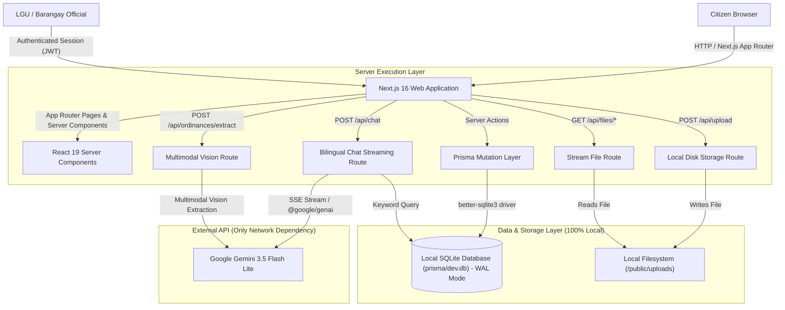

# Cabanatuan City Ordinance Portal
**The Official Municipal and Barangay Ordinance Information Portal of Cabanatuan City**

[](https://nextjs.org/)
[](https://react.dev/)
[](https://www.typescriptlang.org/)
[](https://tailwindcss.com/)
[](https://www.prisma.io/)
[-003B57?style=for-the-badge&logo=sqlite&logoColor=white)](https://www.sqlite.org/)
[](https://ai.google.dev/)
[](https://github.com/jsoul-dev/cabanatuan-city-ordinance-portal/blob/main/LICENSE)

---

## Overview

The **Cabanatuan City Ordinance Portal** is a production web application built for the Local Government Unit (LGU) of **Cabanatuan City** and its **89 constituent Barangays** in Nueva Ecija, Philippines.

The platform provides digital public access to city resolutions, municipal ordinances, and barangay regulations through:
- An indexed, full-text ordinance search directory with slug-based routing.
- A split-screen document inspector supporting dual-mode viewing (structured card sections and canvas-rendered PDF copies).
- A bilingual civic assistant (**Cabanatuan Ordinance AI**) powered by Google Gemini 3.5 Flash Lite with local keyword retrieval (RAG) against SQLite.
- A multimodal OCR ingestion pipeline that extracts structured ordinance metadata directly from scanned PDF files and multi-page image sets.
- A 3D procedural civic archive monolith rendered using Three.js instanced geometry.
- An institutional report generator producing 8 categorized ordinance breakdowns with client-side PDF export.
- Role-based management portals for City LGU Administrators and Barangay Officials.

> [!IMPORTANT]
> **System Scope and Legal Disclaimer:**  
> The **Cabanatuan City Ordinance Portal** is strictly an **information management and public transparency platform**.  
> - **In Scope:** Storing, organizing, searching, viewing, and generating analytical reports on municipal and barangay ordinance records.  
> - **Out of Scope:** The system does **not** offer legal counsel, legal advice, legal interpretation, or statutory representation. It is **not** a law office, legal database authority, or court system. Citizens requiring legal guidance should consult the City Legal Office or qualified counsel.

---

## Core Capabilities

### 1. Public Ordinance Explorer and Document Inspector
- **Full-Text and Faceted Search:** Query ordinances by title, resolution number, year, category (e.g., *Kapayapaan at Kaayusan*, *Kalusugan at Sanitasyon*, *Kalakalan at Negosyo*, *Kapaligiran*), and jurisdiction.
- **Split-Screen Ordinance Detail View (`/ordinances/[slug]`):** Side-by-side reading layout. The primary pane presents parsed structural cards (summary, policy sections, penalties, coverage, enforcement agencies), while the secondary drawer embeds the official signed PDF via a custom canvas viewer (`pdf-canvas-viewer.tsx`).
- **Responsive Theme Support:** Zero-flash dark and light mode rendering using CSS variables and `useSyncExternalStore` for persistent client hydration.

### 2. "Cabanatuan Ordinance AI" Civic Assistant (`/chatbot`, `/api/chat`)
- **Bilingual Natural Language Q&A:** Answers citizen inquiries in Tagalog, English, or Taglish using Google Gemini 3.5 Flash Lite (`@google/genai`).
- **Local Keyword Retrieval (RAG):** Extracts significant terms from citizen questions, filters bilingual stop words, queries the local SQLite database via Prisma, and injects factual ordinance excerpts into the model prompt to cite exact resolution numbers and penalties.
- **Streaming Delivery with In-Band Fault Tolerance:** Server-Sent Events (SSE) streaming with client-side abort controllers, graceful mid-stream error recovery, and rate limit degradation notices.
- **Abuse and Origin Defense:** In-memory client request rate limiter, payload size caps, and Cloudflare proxy origin secret validation to protect public endpoints.

### 3. Multimodal OCR Document Ingestion (`/api/ordinances/extract`)
- **Scanned File Ingestion:** Accepts multi-page digital PDFs, scanned PDFs, or sequence image files (PNG, JPEG, WEBP).
- **Sequential Structural Reconstruction:** The Gemini Vision API processes page sequences to reconstruct complete ordinance titles, resolution identifiers, enactment dates, policy sections, coverage areas, and penalty clauses.
- **Administrative Review Dialog:** Before persistence, LGU and Barangay administrators review and edit AI-extracted fields inside an accessible modal with keyboard navigation (`Escape`, `Enter`).

### 4. 3D Civic Monolith Visualizer (`civic-monolith-canvas.tsx`)
- **Three.js Instanced Mesh Rendering:** Renders an interactive 3D helix tower representing archived city ordinances using procedural textures, dynamic draw buffers, and ambient lighting.
- **Interactive Raycasting:** Supports mouse drag, inertia rotation, raycaster hover detection, and click-to-select.
- **Accessibility and Performance:** Automatically detects `prefers-reduced-motion` to halt continuous rotation and particle simulation; pauses the render loop when scrolled off-screen via `IntersectionObserver`.

### 5. Institutional Report Generator (`/admin/lgu/ordinance-reports`, `/admin/barangay/ordinance-reports`)
- **8 Comprehensive Report Views:**
  1. Complete Ordinance Catalog
  2. Ordinances Grouped by Month
  3. Ordinances Grouped by Barangay
  4. Ordinances Grouped by Submitting Official
  5. Ordinances Grouped by Policy Category
  6. Ordinances Grouped by Approval Status
  7. Ordinances Grouped by Jurisdiction Type (City vs. Barangay)
  8. Ordinances Grouped by Calendar Year
- **Government-Standard PDF Export (`generate-report-pdf.ts`):** Client-side PDF generation using `jspdf` and `jspdf-autotable`. Produces formal letterhead headers, subtotal tallies per group, grand totals, and signature blocks.

### 6. Multi-Tier Governance and RBAC
- **LGU Super Administrator (`/admin/lgu`):** City-wide ordinance approvals, review queue processing, barangay official account provisioning, news management, and executive analytics.
- **Barangay Official (`/admin/barangay`):** Localized ordinance drafting, community incident report triage (`NEW`, `IN_PROGRESS`, `RESOLVED`), and barangay-scoped statistical overviews.
- **Citizen Feedback (`/report`):** Public incident submission form allowing citizens to report local code concerns directly to the relevant barangay administration.

---

## Architecture



---

## Technology Stack

| Domain | Technology | Implementation Details |
| :--- | :--- | :--- |
| **Framework** | [Next.js 16](https://nextjs.org/) | App Router, Turbopack, React 19 Server Components, Server Actions |
| **Language** | [TypeScript 5](https://www.typescriptlang.org/) | Strict type checking across API routes, server actions, and UI |
| **Database** | [SQLite 3](https://www.sqlite.org/) | Local relational storage via `better-sqlite3` and `@prisma/adapter-better-sqlite3` |
| **ORM** | [Prisma 7.9](https://www.prisma.io/) | Schema definition, automated migrations, seed script (`prisma/seed.ts`) |
| **Styling** | [Tailwind CSS v4](https://tailwindcss.com/) | CSS variables design system, dark/light theme tokens, fluid typography |
| **AI Engine** | [Google Gemini 3.5 Flash Lite](https://ai.google.dev/) | `@google/genai` SDK for streaming chat and multimodal document parsing |
| **3D Graphics** | [Three.js](https://threejs.org/) | Procedural instanced mesh helix archive with raycaster interaction |
| **Data Viz** | [Recharts 3](https://recharts.org/) | Interactive bar, area, and pie charts for governance analytics |
| **PDF Generation**| [jsPDF](https://github.com/parallax/jsPDF) + AutoTable | Client-side vector PDF generation for official executive reports |
| **PDF Viewer** | [React-PDF](https://github.com/wojtekmaj/react-pdf) | Canvas-rendered PDF display with responsive zoom and navigation |
| **Authentication**| [jose](https://github.com/panva/jose) + [bcryptjs](https://github.com/dcodeIO/bcrypt.js) | Stateless HTTP-only JWT session cookies with bcrypt password hashing |

---

## Directory Structure

```text
cabanatuan-city-ordinance-portal/
├── manage.bat                    # Windows interactive manager script (setup, dev, demo, studio)
├── prisma/
│   ├── schema.prisma             # Relational data schema (Ordinances, Barangays, Users, Reports)
│   ├── seed.ts                   # Realistic seed script for Cabanatuan City and test barangays
│   └── prisma.config.ts          # Prisma CLI configuration
├── public/
│   ├── logos/                    # Official Cabanatuan City and seal assets
│   └── uploads/                  # Local storage destination for uploaded ordinance documents
├── src/
│   ├── app/
│   │   ├── admin/
│   │   │   ├── lgu/              # City LGU Admin dashboard (ordinances, reports, users, analytics)
│   │   │   └── barangay/         # Barangay Admin dashboard (ordinance drafting, local reports)
│   │   ├── api/
│   │   │   ├── chat/             # Streaming AI civic assistant route with SQLite keyword RAG
│   │   │   ├── files/            # Local file stream handler for stored PDFs and images
│   │   │   ├── ordinances/extract/ # Multimodal OCR route parsing documents via Gemini Vision
│   │   │   └── upload/           # Multipart file upload handler writing to disk
│   │   ├── chatbot/              # Full-page citizen AI conversational interface
│   │   ├── login/                # Role-based authentication portal
│   │   ├── ordinances/           # Public ordinance directory and search interface
│   │   │   └── [slug]/           # Split-screen card and PDF document inspector
│   │   ├── report/               # Public civic violation and issue reporting form
│   │   └── page.tsx              # Homepage featuring 3D archive canvas and search hero
│   ├── components/
│   │   ├── 3d/                   # Three.js instanced mesh archive monolith canvas
│   │   ├── dashboard/            # Admin headers, sidebars, metrics, AI extractor dialog
│   │   ├── layout/               # Universal responsive navbar and institutional footer
│   │   ├── reports/              # Tabular report containers, group tables, summary totals
│   │   └── ui/                   # Button, Card, Badge, Input, ThemeToggle, PDFCanvasViewer
│   └── lib/
│       ├── auth.ts               # JWT cookie signing, verification, and session helpers
│       ├── dashboard-queries.ts  # Analytics aggregation and dashboard metrics queries
│       ├── design-tokens.ts      # Brand palette, spacing, and typography constants
│       ├── generate-report-pdf.ts # jsPDF report builder with institutional styling
│       ├── ordinance-report-queries.ts # Multi-parameter filtered queries for ordinance reports
│       ├── ordinance-utils.ts    # Slug generation, status formatters, resolution helpers
│       └── prisma.ts             # PrismaClient singleton configured with SQLite WAL pragmas
└── package.json
```

---

## Quickstart Guide

### Prerequisites
- **Node.js** `>= 20.0.0`
- **npm** (comes with Node.js)
- A **Google Gemini API Key** from [Google AI Studio](https://aistudio.google.com/) (the only external service requirement)

### 1. Clone the Repository
```bash
git clone https://github.com/jsoul-dev/cabanatuan-city-ordinance-portal.git
cd cabanatuan-city-ordinance-portal
```

### 2. Install Dependencies
```bash
npm install
```

### 3. Configure Environment Variables
Create a `.env` file in the project root:

```env
# Database (Local SQLite)
DATABASE_URL="file:./prisma/dev.db"

# Authentication Secret
JWT_SECRET="cabanatuan-city-secure-jwt-key-minimum-32-chars-long"

# Google Gemini API
GEMINI_API_KEY="your-gemini-api-key-here"
GEMINI_MODEL="gemini-3.5-flash-lite"
```

### 4. Initialize Database and Seed Data
Run the automated setup script to push the schema and seed sample ordinances, barangays, and user accounts:

```bash
npm run db:setup
```

### 5. Start the Application

#### Option A: Development Mode (Hot Reload)
```bash
npm run dev
```
Open [http://localhost:3000](http://localhost:3000) in your browser.

#### Option B: Production Demo (Optimized Build)
```bash
npm run demo
```
Compiles with Turbopack and starts the production server on port 3000.

#### Option C: Windows Interactive Manager (`manage.bat`)
On Windows, you can double-click **`manage.bat`** or run commands directly from terminal:
- `manage.bat setup` : Run Prisma generate, push, and seed.
- `manage.bat dev` : Launch development server on port 3000.
- `manage.bat demo` : Build and launch production server on port 3000.
- `manage.bat studio` : Open Prisma Studio database viewer on port 5555.
- `manage.bat reset-db` : Delete `dev.db` and re-seed from scratch.
- `manage.bat stop` : Kill active portal processes on ports 3000 and 5555.

---

## Seeded Test Accounts

The seed script creates initial accounts for local testing across all user roles:

| Role | Email Address | Password | Scope and Permissions |
| :--- | :--- | :--- | :--- |
| **LGU Super Admin** | `admin@cabanatuan.gov.ph` | `admin123` | City-wide governance, approvals, user creation, executive reports |
| **Barangay Captain** | `kapitan@cabanatuan.gov.ph` | `kapitan123` | Scoped to Barangay Camp Tinio: ordinance drafting, local report resolution |
| **Citizen (Public)** | `juan@cabanatuan.gov.ph` | `citizen123` | Public ordinance search, civic assistant access, community reporting |

---

## Database Architecture and SQLite WAL Mode

The portal uses a 100% local SQLite database (`prisma/dev.db`) initialized with high-concurrency pragmas in `src/lib/prisma.ts`:

```sql
PRAGMA journal_mode = WAL;
PRAGMA synchronous = NORMAL;
PRAGMA busy_timeout = 5000;
```

### Concurrency Benefits
- Write-Ahead Logging (WAL) allows concurrent readers while a write transaction is executing.
- Non-blocking read operations prevent user search queries and AI RAG lookups from waiting on administrative ordinance uploads.

### Live Backup Procedure
When SQLite is operating in WAL mode, recent commits exist in `prisma/dev.db-wal` before being checkpointed into `prisma/dev.db`.
- **Do not copy only `dev.db`** while the server is actively running.
- For a safe live backup, copy all three related files together (`dev.db`, `dev.db-wal`, `dev.db-shm`), or run a checkpoint command:
  ```bash
  sqlite3 prisma/dev.db "VACUUM INTO 'prisma/backup.db'"
  ```

---

## Verification and Quality Standards

The codebase adheres strictly to rigorous hygiene and production readiness standards:
- **Zero Lint Errors:** Run `npm run lint` to verify that all ESLint and React 19 rules pass with 0 errors and 0 warnings.
- **Production Compilation:** Run `npm run build` to verify TypeScript type checking and compilation across all 31 static and dynamic routes.
- **Accessibility:** All interactive modals feature WAI-ARIA roles, focus trapping, `Escape` key dismiss listeners, and backdrop click handling.

---

## License and Attribution

Copyright (c) 2026 **Lungsod ng Cabanatuan** (Cabanatuan City Local Government Unit).  
Distributed under the **[MIT License](https://github.com/jsoul-dev/cabanatuan-city-ordinance-portal/blob/main/LICENSE)**.
